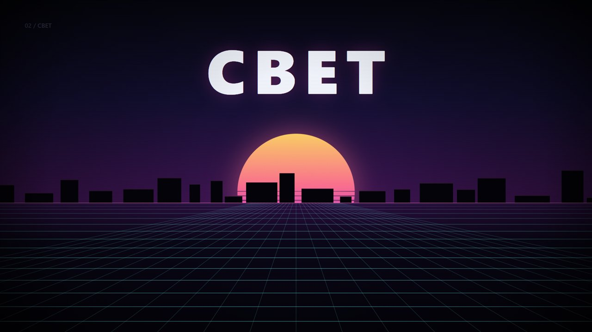

# code-video

**English version:** [README.md](README.md)

Плагин-учебник для агента: как делать видео целиком из кода — один HTML-файл, Canvas 2D или Three.js, звук синтезируется через Web Audio, на выходе MP4 или WebM.

Внутри не «вдохновляющие советы», а рабочие приёмы с числами: тайминги, кривые, уровни в дБ, точные команды ffmpeg и грабли, на которых обычно ломается рендер.



---

## Что внутри

```
code-video/
├── SKILL.md                    главный мануал: контракт кадра, процесс, антипаттерны
├── README.md                   этот файл
├── references/
│   ├── 01-pipeline.md          архитектура файла, слои, бюджет кадра
│   ├── 02-timing-and-easing.md сетка BPM, easing, камера, тайминги текста
│   ├── 03-visual-style.md      4 стилевые системы, палитры, свет, композиция
│   ├── 04-transitions.md       каталог переходов с кодом
│   ├── 05-effects.md           glow, зерно, частицы, CRT, глитч, блюр
│   ├── 06-typography.md        кинетическая типографика и русский текст
│   ├── 07-audio.md             синтез, партитура, микс, офлайн-рендер в WAV
│   ├── 08-3d.md                Three.js: свет, шейдеры, частицы, bloom
│   ├── 09-render.md            CDP, ffmpeg, контактные листы, BT.709
│   ├── 10-qa.md                чек-листы и таблица дефектов
│   └── 11-longform.md          ролики 60–180 секунд
├── assets/
│   └── skeleton.html           рабочий шаблон: 24 с, 4 сцены, звук, запись в WebM
└── scripts/
    └── render.mjs              покадровый рендер без npm-зависимостей
```

---

## Быстрый старт

Открыть `assets/skeleton.html` двойным щелчком в Chrome:

- кнопка **▶** включает звук и запускает;
- **●** пишет WebM со звуком через `MediaRecorder`;
- `skeleton.html?t=14` — статичный кадр на 14-й секунде (для отладки сцен);
- пробел — пауза, стрелки — перемотка на 2 секунды.

Шаблон уже содержит то, что обычно переписывают заново: контракт `__meta / __draw / __ready`, транспорт с Web Audio, партитуру из событий, офлайн-рендер звука в WAV и запись.

---

## Рендер в MP4

```bash
node scripts/render.mjs --html assets/skeleton.html --out out
```

Что делает скрипт:

1. поднимает headless Chrome и ждёт `window.__ready`;
2. вызывает `window.__draw(t)` для каждого кадра, снимает PNG через CDP;
3. забирает звук: `window.__audioWav()` рендерит партитуру в `OfflineAudioContext` за секунды, без реального времени;
4. склеивает `ffmpeg` в H.264 + AAC (BT.709, `-crf 18`).

Полезные режимы:

```bash
# только кадры для проверки сцен
node scripts/render.mjs --html film.html --out out --stills "2,8,14,20"

# фрагмент на 60 fps
node scripts/render.mjs --html film.html --out out --fps 60 --from 4 --to 12

# готовый MP4 + контактный лист
node scripts/render.mjs --html film.html --out out --sheet
```

Если ffmpeg не установлен — скрипт всё равно отрендерит PNG и `audio.wav` и напечатает готовую команду для склейки.

**Требования:** Node 22+ (нужен глобальный `WebSocket`; проверено на 24), Chrome или Edge. ffmpeg — опционально.
Windows: Chrome ищется в стандартных путях, можно задать `--chrome "путь"`.

---

## Установка

Пакет — это папка со `SKILL.md` внутри. Ставится копированием: ни сборки, ни npm, ни зависимостей.

### Как скилл

Скопировать папку `code-video` в каталог скиллов агента:

| Агент | Куда копировать |
|---|---|
| DSH | `~/.dsh/skills/code-video/` |
| Claude Code | `~/.claude/skills/code-video/` |
| Codex, Gemini CLI, Cursor | `~/.agents/skills/code-video/` |

Проектный вариант — те же имена внутри репозитория: `<проект>/.dsh/skills/`, `<проект>/.claude/skills/`, `<проект>/.agents/skills/`. Тогда скилл виден только в этом проекте.

Windows, из скачанного архива:

```powershell
Expand-Archive -Path "$env:USERPROFILE\Downloads\code-video.zip" `
               -DestinationPath "$env:USERPROFILE\.dsh\skills" -Force

# проверить: должно быть True
Test-Path "$env:USERPROFILE\.dsh\skills\code-video\SKILL.md"
```

Linux и macOS:

```bash
unzip code-video.zip -d ~/.dsh/skills/
test -f ~/.dsh/skills/code-video/SKILL.md && echo ok
```

Главное — чтобы получилось `code-video/SKILL.md`, а не `code-video/code-video/SKILL.md`. Если при распаковке появился лишний уровень, папку нужно поднять на один вверх.

Скилл включается сам, когда задача про видео, анимацию, титры или графику. Принудительно — по имени: `/code-video`.

### Проверка, что работает

1. Спросить агента: «сделай html видео со звуком» — он должен сослаться на `code-video`.
2. Или открыть шаблон напрямую: `assets/skeleton.html` двойным щелчком, нажать ▶ — пойдёт звук и картинка.
3. Или собрать кадры из шаблона: `node scripts/render.mjs --html assets/skeleton.html --out out --stills "2,8,14,20"` — в `out/` появятся PNG.

### Удаление

```powershell
Remove-Item "$env:USERPROFILE\.dsh\skills\code-video" -Recurse -Force
```

### Как плагин DSH (необязательно)

Если нужен именно плагин, а не папка со скиллом: положить содержимое в профиль и добавить запись в `cordis.patch.yml` —

```yaml
- insert:
    - id: code-video-plugin
      name: "./plugins/code-video/index.mjs"
```

Новый плагин добавляется только через `insert`, запись вида `- id: ...` в пользовательском слое патчей даёт ошибку `entry "..." not found`.

---

## Три принципа, на которых всё держится

1. **Кадр — чистая функция времени.** `draw(t)` не помнит предыдущий кадр. Отсюда перемотка, покадровый рендер и повторяемость пиксель в пиксель.
2. **Звук — партитура, а не файл.** Массив `{t, type, ...}` читают и синтезатор, и таймлайн. Один источник правды — идеальная синхронизация.
3. **Один файл.** Ни картинок, ни шрифтов, ни mp3, ни CDN. Открывается двойным щелчком и рендерится офлайн.

---

## Проверено

- `skeleton.html` отрендерен в headless Chrome: 8 контрольных кадров, 1920×1080, без исключений в консоли.
- Звук: 24.6 с, 2 канала, 44.1 кГц, пик −1.4 дБ, RMS в груве ≈ −20 дБ.
- `render.mjs`: путь PNG + WAV проверен целиком; MP4-ветка — стандартный ffmpeg H.264/AAC.
- Синтаксис `skeleton.html` и `render.mjs` проверен через `node --check`; внешних запросов и секретов в пакете нет.

Расхождение, которое стоит знать: ffmpeg в этой среде не стоял, поэтому последний шаг склейки проверяется отдельно.

---

## Лицензия

MIT. Делай что хочешь, ссылка не обязательна.
